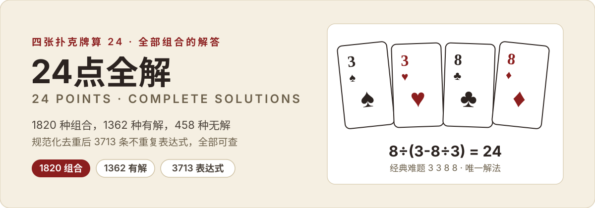
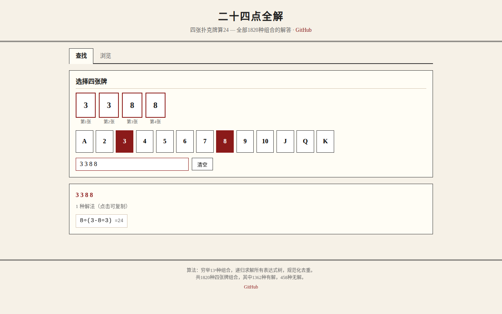
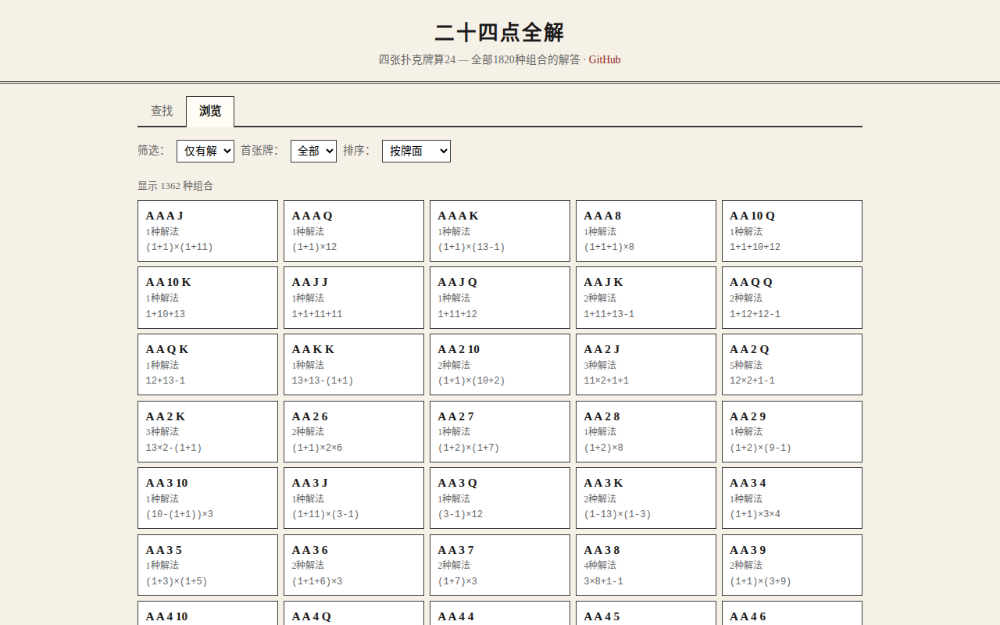

<p align="right"><a href="README.md">中文</a></p>

<p align="center">
  
</p>

<p align="center">
  <a href="https://24points.xiaosang.cc/">▶ Look Up Answers</a>
  ·
  <a href="https://holynova.github.io/24points/">GitHub Pages Mirror</a>
  ·
  <a href="https://github.com/holynova/24points">GitHub Repository</a>
</p>

24 Points is a complete answer book for the 24 Game: all 1,820 four-card combinations from A–K — 1,362 solvable, 458 unsolvable — with 3,713 unique expressions after normalization and dedup, all searchable offline. Enter any four cards to see every solution, or browse all combinations sorted by solution count.

## Screenshots

<p align="center">
  
</p>

<p align="center">
  
</p>

## Features

- **Look up any four cards**: click the card buttons or type directly (e.g. `3 3 8 8`, `A 5 5 9`) to list every solution.
- **Browse all combinations**: a grid of all 1,820 combinations, filterable by solvable/unsolvable or first card, sortable by cards or solution count.
- **Click to copy**: click any expression to copy it, including `= 24`.
- **Complete stats**: 1,362 solvable (426 with exactly 1 solution; the richest hand is 3, 4, J, K with 13) and 458 unsolvable.
- **Fully offline**: answers are precomputed into `solutions.json` / `docs/data.js` — open the page and look them up, no network solving needed.
- **Responsive** on mobile and desktop.

## Algorithm

Every four-card combination is enumerated (C(13+4-1, 4) = 1,820), expression trees are generated recursively, then deep normalization removes duplicates:

- addition/subtraction terms are collected and sorted, as are multiplication/division terms (flattening by commutativity and associativity);
- identity elimination (×1, ÷1, +0, −0);
- subtraction is rewritten as adding a negative, division as multiplying by a reciprocal, then sorted back.

That leaves 3,713 unique expressions. To regenerate the answer book:

```bash
node solver.js > solutions.json
```

## Run Locally

Just open `index.html` — no server needed (single file, data embedded). `docs/` is the GitHub Pages publish directory (`docs/index.html` + `docs/data.js`).

## Tech

- Zero frameworks, zero dependencies: vanilla HTML/CSS/JavaScript; the solver is a pure Node script (`solver.js`, ~1e-9 float tolerance).

```
index.html        Single-file app (data embedded)
docs/index.html   Pages entry point
docs/data.js      Answer book (window.__SOLUTIONS)
solutions.json    Answer book JSON (meta + solutions)
solver.js         Exhaustive solving + normalization dedup
```
