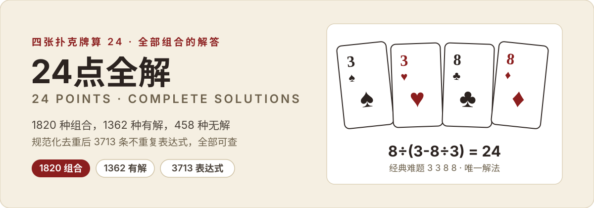
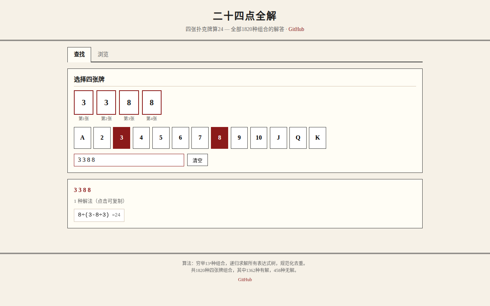
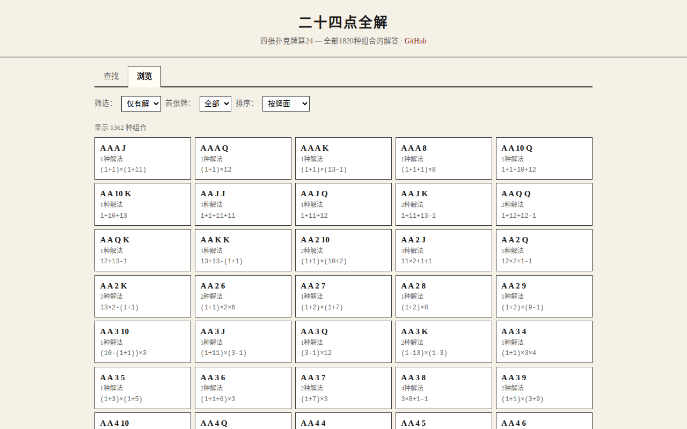

<p align="right"><a href="README.en.md">English</a></p>

<p align="center">
  
</p>

<p align="center">
  <a href="https://24points.xiaosang.cc/">▶ 在线查答案</a>
  ·
  <a href="https://holynova.github.io/24points/">GitHub Pages 镜像</a>
  ·
  <a href="https://github.com/holynova/24points">GitHub 仓库</a>
</p>

24点全解是四张扑克牌算 24 的完整答案库：A~K 四张牌的全部 1820 种组合，1362 种有解、458 种无解，规范化去重后共 3713 条不重复表达式，全部离线可查。输入任意四张牌，看所有解法；或浏览全部组合，按解法数排序。

## 截图

<p align="center">
  
</p>

<p align="center">
  
</p>

## 功能

- **查任意四张牌**：点牌面按钮，或直接输入（如 `3 3 8 8`、`A 5 5 9`），列出全部解法。
- **浏览全部组合**：1820 种组合网格，可按有解/无解筛选、按首张牌筛选、按牌面或解法数排序。
- **点击复制**：点任意表达式复制，含 `= 24`。
- **完整统计**：1362 种有解（426 种仅 1 解，最多 13 解：3、4、J、K）、458 种无解。
- **离线可用**：答案预计算在 `solutions.json` / `docs/data.js`，打开页面即查，无需联网求解。
- **移动端与 PC 自适应**。

## 算法

穷举全部四张牌组合（C(13+4-1, 4) = 1820），递归枚举表达式树，再经深度规范化去重：

- 加减法统一收集排序、乘除法统一收集排序（交换律、结合律展平）；
- 恒等消除（×1、÷1、+0、−0）；
- 减法统一为加负数、除法统一为乘倒数后再排序还原。

去重后 3713 条表达式。重新生成答案库：

```bash
node solver.js > solutions.json
```

## 本地运行

直接打开 `index.html` 即可，无需服务器（单文件，数据内嵌）。`docs/` 是 GitHub Pages 发布目录（`docs/index.html` + `docs/data.js`）。

## 技术

- 零框架、零依赖：原生 HTML/CSS/JavaScript；求解器是纯 Node 脚本（`solver.js`，约 1e-9 浮点容差）。

```
index.html        单文件应用（数据内嵌）
docs/index.html   Pages 版入口
docs/data.js      答案库（window.__SOLUTIONS）
solutions.json    答案库 JSON（meta + solutions）
solver.js         穷举求解 + 规范化去重
```
